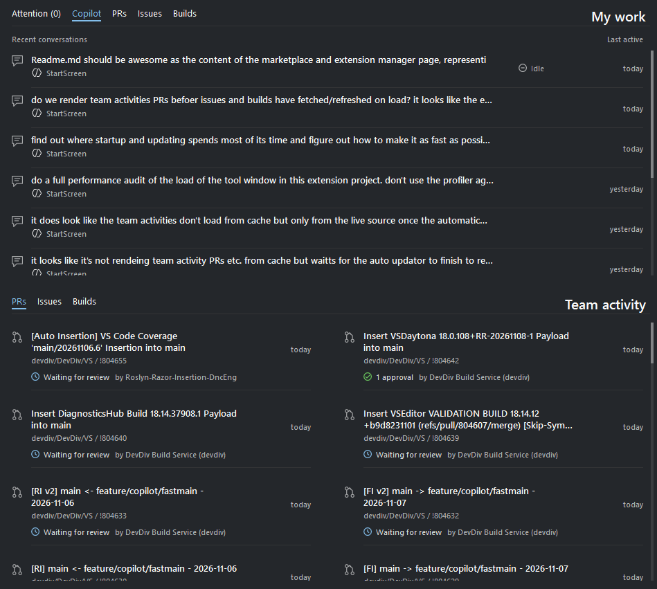
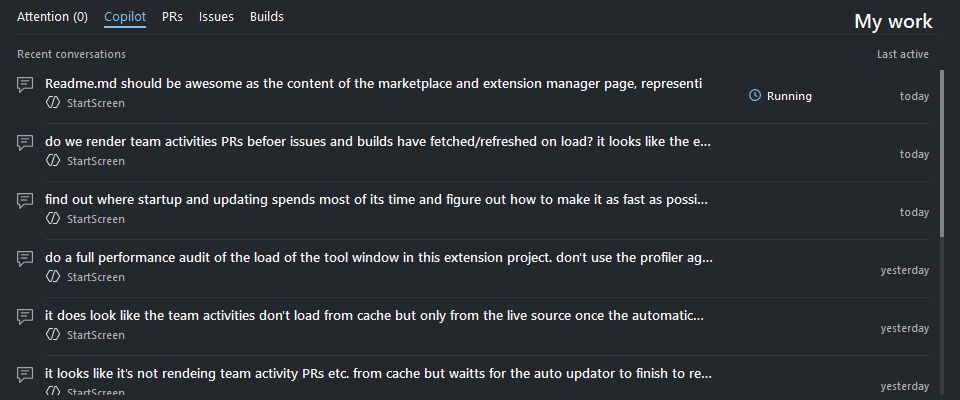
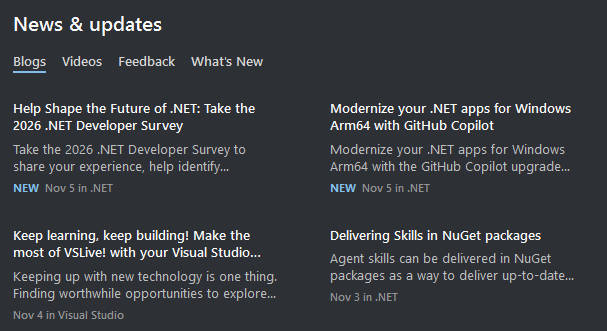

[marketplace]: <https://marketplace.visualstudio.com/items?itemName=MadsKristensen.StartScreen>
[vsixgallery]: <https://www.vsixgallery.com/extension/StartScreen.2d76ac3d-7ff2-47e1-82d8-e507cf765bbe>
[repo]: <https://github.com/madskristensen/StartScreen>

# Start Screen for Visual Studio

**Less hunting. More coding.**

Your projects, pull requests, Copilot conversations, and developer news - together in a start screen that feels right at home in Visual Studio.

Pick up where you left off, see what needs your attention, and get back to building.

Download from the [Visual Studio Marketplace][marketplace] or get the latest [CI build][vsixgallery].

> **Requires Visual Studio 2022** or later. Free and open source.

## Start your next coding session here

| Instead of... | Start Screen lets you... |
| --- | --- |
| Searching for yesterday's solution | Find it as you type, or keep it pinned at the top |
| Opening repositories just to check their state | See branches, local changes, and ahead/behind counts before opening |
| Switching between browser tabs to find your next task | Bring pull requests, issues, and builds into your IDE |
| Hunting for the Copilot chat you were using | Return to recent conversations from your workspace dashboard |
| Missing the latest Visual Studio updates | Browse blogs, videos, and What's New alongside your work |

## Your projects, ready when you are

Make your recent-project list a launchpad, not a filing cabinet.

- **Find and pin your favorites.** Search your saved history by project name, path, or tag (including partial, case-insensitive matches), pin frequently used workspaces, and drag pinned items into your preferred order.
- **See recent opens immediately.** Date groups use Visual Studio's recorded last-opened time as soon as the list loads, without waiting for background Git or filesystem details.
- **Organize projects with tags.** Right-click a recent project and choose **Add tags...** or **Remove tags...** to open a compact tag selector. Hold **Ctrl** while clicking projects to select several, then right-click a selected project to tag them together. The Open commands and Copy Path are shown only for a single selected project. Adding or removing selected tags preserves their other tags. A tag disappears automatically from suggestions and filter chips when its last use is removed; any active filter for it is cleared. Tags share a compact details line with review requests and worktree counts. Long tag summaries truncate with the full list in a tooltip, keeping recent-project rows the same height as metadata loads. Rows scale with the Visual Studio font size. Click the tag chips below search to filter (all selected tags must match); **Clear** returns to all projects without removing tags. Tags are saved locally and work alongside search and pinned projects. Existing saved tags are retained; saved collections are no longer used.
- **Know before you open.** Check the current Git branch, uncommitted changes, ahead/behind counts, and last commit time at a glance. Newly opened projects and folders load these details and repository review counts automatically when they appear in the list.
- **Switch between worktrees.** Visible recent projects discover existing Git worktrees automatically in the background. A fork icon and count appear only when other working checkouts exist. Right-click a single project and choose **Open Worktree** to open a checkout in this window. Hold **Shift** while selecting a checkout to open it in a new Visual Studio instance instead. Entries show branch and folder names; the current checkout is checked and can also be opened in a new instance, and bare or prunable entries cannot be opened. **Prune deleted worktrees...** appears at the bottom of the flyout when stale, unlocked registrations exist. After confirmation it runs `git worktree prune --expire=now` and refreshes the badges and lists. It does not delete working files or branches, and locked worktrees are preserved. Do not prune worktrees that were moved or are on disconnected drives; pruning discards their registration and recovery information. Discovery itself remains read-only, cached per repository, shared across checkouts, and renewed when Start Screen is reopened or explicitly refreshed. It requires Git on PATH and limits concurrent discovery commands.
- **Start a workspace chat.** Right-click one project and choose **New Chat Session** to create an empty, persistent Copilot conversation in that workspace's directory (the containing directory for solution or project files). No prompt is sent automatically. This uses optional Copilot harness capabilities: the backend must either already use that directory or support changing it. The directory is verified before reporting success. Unsupported, failed, or canceled attempts remove only the newly created empty conversation and report any failure instead of leaving a chat in the wrong workspace.
- **Preview the work.** Select one workspace to see its repository activity. A scope strip appears only when a workspace is selected; **Clear filter** returns to unfiltered activity and hides the strip. Selecting multiple projects keeps activity across all repositories instead of using the last clicked project. Double-click or press Enter when you're ready to open a workspace.
- **Take the shortcut.** Open a terminal or containing folder, pull Git changes, copy a path, or launch a new Visual Studio instance from the context menu.
- **Drop it and go.** Drag a solution, project, or folder from File Explorer onto Start Screen to open it.

Need something new? The action bar puts **Create a new project**, **Open**, **Clone**, and **Attach to process** within reach.

## See what needs you - before diving into code

**Dev Hub** brings activity from **GitHub, Azure DevOps, and Bitbucket** next to your projects. Spend less time finding the work and more time moving it forward.

**My work** gathers your pull requests, created or assigned issues and tasks, builds, and Copilot sessions. The **Attention** feed highlights known actions such as requested reviews, failing checks on your PRs, and assigned work.

**Team activity** keeps your teammates' pull requests, issues, and repository builds in view. Select a recent workspace to focus on one repository, or choose **All repositories** for the bigger picture.

Review pull requests in Visual Studio where supported, or open them on the web. Review and check status help you decide where to start; **Ready to merge** appears only when the provider supplies verified readiness.

**Pin or snooze activity** from a repository item's native context menu (right-click or Shift+F10). Choose **Pin to Attention** to add an active PR, issue, or build to Attention, including items from Team activity. Pinned items appear first. **Unpin from Attention** removes your pin; an item with an automatic attention reason stays until that reason clears or you snooze it. Completed items are not added to Attention. Snooze an item for one hour or one day to hide it from both activity feeds and their counts until it expires. Select **Show snoozed items** below **Solutions only** in the lower-left corner to see it again and choose **Unsnooze item** to restore it early. Pins and snoozes are saved locally; they do not change provider ownership, bypass repository scope or type filters, or fetch items outside the loaded activity.

Repository activity requires a connected provider account. When a workspace is selected, account warnings and connection prompts apply only to that repository's provider; **All repositories** shows account recovery for all enabled providers. Available activity and actions vary by provider and permissions; these are recent activity feeds, not exhaustive repository inventories.

## Keep Copilot in the loop

Your next step can start right from the work item.

- **Fix with Copilot** starts a local Visual Studio chat for an issue or task.
- **Investigate with Copilot** brings a failed build's context into a new chat.
- **Continue in Copilot** returns to a conversation started for that item, without sending the same prompt again.
- **Request Copilot Review** requests a review on supported GitHub.com pull requests, with confirmation.

The Copilot tab also brings recent Visual Studio and CLI conversations, plus GitHub cloud-agent tasks, into view. Open a conversation in its originating app; supported live Visual Studio sessions can surface questions or permission requests in Attention.

Copilot integration is optional and experimental, and depends on compatible installed Visual Studio Copilot components. CLI resume requires the Copilot CLI on PATH. Cloud tasks and review requests require the relevant GitHub permissions and Copilot access; review requests may consume Copilot usage. Start Screen never answers permission requests automatically.

## Stay current without leaving your IDE

The **News & updates** sidebar gives you more than headlines:

- **Blogs** - curated developer news from sources including the Visual Studio and .NET blogs, with support for your own RSS or Atom feeds.
- **Videos** - recent videos from the Visual Studio YouTube channel.
- **Events** - upcoming developer conferences, with descriptions, thumbnails, and confirmed dates and locations on one line. Click an event card (or press Enter or Space when focused) to open its official page in your default browser. Routine update and cache messages are hidden; errors and empty-state notices remain visible. Visual Studio Live! entries link to the Visual Studio subscriber discount benefit; eligibility and the amount depend on your subscription and the event.
- **What's New** - features shipped with your installed Visual Studio version.
- **Feedback** - Developer Community tickets you created or upvoted, with their latest status, using your signed-in Visual Studio account.

Browse when you want to. Background loading and local caches keep available content close at hand; Feedback, Videos, and Events load on demand.

**Events load only when you activate the Events tab**, using the HTTPS [raw events feed](https://raw.githubusercontent.com/madskristensen/StartScreen/master/events.json). The schedule and thumbnails are cached locally for seven days. Refresh while Events is selected to bypass the schedule cache; refreshing other pages never downloads events. Failed updates retain the last good schedule with an explicit stale-cache message. Without a cached schedule, an unavailable feed shows a retry message rather than inventing events. Ended events and entries without an exact start date are hidden on each activation, even when the cache is fresh. Ongoing events remain visible, followed by upcoming events in chronological order.

To curate conferences, edit [events.json](events.json) and publish it to the repository's `master` branch. Keep `version` at `1`. Each dated entry needs `name`, `description`, `startDate` (ISO `yyyy-MM-dd`), `location` in `City, Country` format (or `Virtual` for online-only events), an HTTPS `url`, and an HTTPS PNG/JPEG `thumbnailUrl`; `endDate` is optional and inclusive. Keep official verification links in `sources`. Set `subscriberDiscountUrl` only for confirmed benefits. Unknown dates remain `null` until officially announced; do not infer next year's dates. The initial list includes .NET Conf as well as the requested conference families, with Build 2027, GitHub Universe 2027, and DEVintersection waiting for confirmed dates. No bundled copy is used as a substitute for the live feed: the new JSON must be published before the raw URL can serve it.

## Make it feel like your Visual Studio

Start Screen follows your IDE theme and font settings, including High Contrast. Native context menus and familiar controls keep it feeling like part of Visual Studio, not a separate app.

Prefer a simpler dashboard? **Hide Dev Hub** and give news more space. Customize provider connections, activity sorting, and GitHub team queries. Your pinned projects and feed preferences are saved automatically.

**Keyboard-friendly from the first click:**

| Shortcut | Action |
| --- | --- |
| Ctrl+Shift+Alt+Backspace | Open Start Screen |
| Alt+` | Focus recent-project search |
| Arrow keys | Navigate projects, activity, and news |
| Enter | Open the selected item |
| Ctrl+Enter | Open a selected recent workspace in a new VS instance |
| P | Pin or unpin a selected recent workspace |
| Shift+F10 | Open the focused item's context menu |

## Get started in three steps

1. **[Install from the Visual Studio Marketplace][marketplace].** You can also search for **Start Screen** in Visual Studio's Extension Manager.
2. **Restart Visual Studio** to finish installation.
3. **Open File > Start Screen**, use the **Home** button on the Standard toolbar, or press **Ctrl+Shift+Alt+Backspace**. Pin your favorite workspace and connect the providers you use in Dev Hub settings.

Start Screen appears when no solution or folder is open and returns after you close a solution. On first use, it disables the built-in Start Window so you don't have two competing launch experiences.

**Your recent projects and news work without connecting a repository provider.** Add Dev Hub and Copilot when you're ready.

## Contributing

This is a passion project, and contributions are welcome!

- **Found a bug?** [Open an issue](https://github.com/madskristensen/StartScreen/issues/new)
- **Have an idea?** [Suggest a feature](https://github.com/madskristensen/StartScreen/issues/new)
- **Want to contribute?** Pull requests are always welcome. [Explore the source code][repo] to get started.
