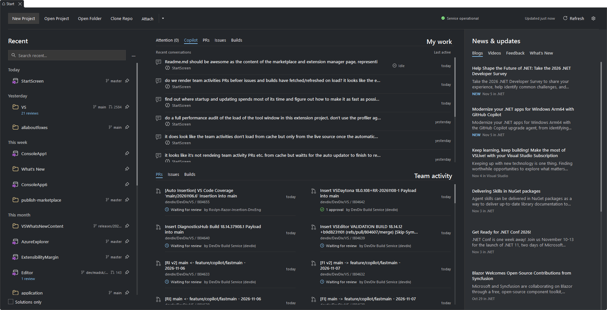
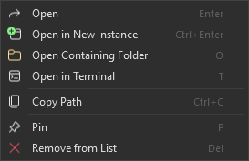
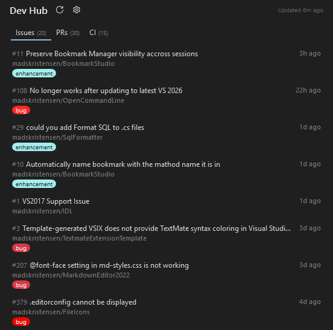

[marketplace]: <https://marketplace.visualstudio.com/items?itemName=MadsKristensen.StartScreen>
[vsixgallery]: <https://www.vsixgallery.com/extension/StartScreen.2d76ac3d-7ff2-47e1-82d8-e507cf765bbe>
[repo]: <https://github.com/madskristensen/StartScreen>

# Start Screen for Visual Studio

[](https://github.com/madskristensen/StartScreen/actions/workflows/build.yaml)
[][vsixgallery]
[](https://github.com/sponsors/madskristensen)

Download this extension from the [Visual Studio Marketplace][marketplace]
or get the latest CI build from [Open VSIX Gallery][vsixgallery].

----------------------------------------------

**Your first five seconds in Visual Studio should feel *fast*.** Start Screen
replaces the default launch experience with a clean, modern dashboard that
gets you into code immediately - no clicking through menus, no waiting.

### Startup and background work

The action bar and search are available before secondary content loads.
One themed progress bar overlays the action-bar separator across the screen for
Dev Hub, provider sign-in, Copilot connection, news, and other background refreshes.
It counts completed authentication, activity categories, discovered repositories,
cache reads/writes, Copilot connection stages, and other section refreshes. Totals
expand as repositories are discovered; this is work-item progress, not an estimate
of remaining time. Its muted theme color and reserved space keep refreshes unobtrusive.
The header's last-updated caption shows the current step while work is running,
including account checks, provider activity, and Copilot discovery, then returns to
the last successful update time. Parallel operations continue independently; the
caption describes one active operation. Extra connecting and updating labels are
omitted; refresh failures are reported in Output, while sign-in recovery links remain.
Recent projects become clickable without waiting for filesystem timestamps, existence
checks, Git metadata, or history writes. Those details are filled in afterward;
Your Work and activity loading run alongside recent projects, so PRs can appear
without waiting for MRU completion. Repository summaries and news start after the
UI has yielded to rendering and user input. Cache reads, feed parsing, and thumbnail
decoding run on background threads with bounded disk and network concurrency.
Video metadata and unread markers load in the background, but thumbnails are fetched
only after selecting Videos and only for displayed cards. Thumbnail loading does not
delay the feed freshness check. Feedback loads when its tab is requested.
Feedback service initialization is deferred until that demand too, including its
HTTP client and title parser. Ticket loading keeps up to four requests in flight,
starting the next ticket as soon as a slot is available rather than waiting for an
entire batch. A failed ticket request cancels the other workers and never publishes
an incomplete success. Parsed recent-project history is reused while its exact
settings JSON is unchanged; edited or cleared history takes effect on the next read.
The async tool window factory starts the activity cache read, repository discovery,
and account verification alongside recent-project loading, before constructing the
content. The control reuses that work and displays each provider's verified cached
activity as it becomes available, without waiting for recent projects or other
providers. Network verification does not delay creation of the window itself.
Account checks that do not need repository discovery overlap the local repository
scan. That scan reads recent-project paths without loading solution timestamps or
other unrelated MRU metadata. Repository-dependent providers reuse the scan result,
and cached PRs still wait for both repository-context and account validation.
Fresh cached Git remotes avoid repeating repository scans during this validation.
Verified provider profiles are reused for five minutes only while the current
credential, account generation, and provider endpoint still match. This avoids
repeating profile requests between cache restoration and background updates.
Manual Refresh revalidates provider profiles.
Verified cached activity yields to rendering before a stale activity refresh starts.
Recent-project details are also persisted locally: Git branch and status, commit
time, ahead/behind counts, stashes, operations, existence, last access, and Copilot
session counts are restored before the first list publication. Repository counts
and activity tooltips are restored after the matching activity identity is verified.
Cached details remain visible while stale entries refresh in the background.
Local metadata and repository counts are reused for three hours; manual Refresh
always reloads them. Merely reopening the screen does not fetch fresh metadata.
Automatic local metadata work is limited to realized, pinned, and selected recent
projects. Offscreen history remains searchable and is enriched when its cards appear;
manual Refresh still reloads the full history. Initial enrichment reuses the published
MRU inventory rather than retrieving it again. Local workspace metadata is published
progressively by two background workers in batches of up to eight, with selected and
pinned workspaces scheduled first.
Repository summaries start as local metadata arrives, independently of remote Git
fetches. Copilot session and solution timestamp scans are shared within each pass
for workspaces using the same directories. Search keeps the existing bound list
and avoids resetting it when the matching items and their groups have not changed.
The saved recent-project column width is applied before the first render, so it
does not shift when background content loads.
Recent-project, news, and video cards build their menu commands and icons only
when first requested, including keyboard requests. Keyboard navigation reuses
realized recent-project cards without forcing a layout pass. Workspace shell
launches, folder probes during open and drag-and-drop, feed configuration disk
work, and Copilot session recounts run off the UI thread. Drag-over events share
their pending folder probe instead of repeatedly accessing the filesystem.
Dev Hub does not read its cache or authenticate providers when disabled.
Recent projects use the host's code-container registry so its persistence serializer
remains compatible across Visual Studio versions. An initial MRU failure is logged
without preventing Dev Hub or news from loading. Azure DevOps identity requests use
the preview version required by the connection-data endpoint.

Each dashboard refresh discovers its repository context once and shares that
snapshot between personal and repository activity queries. Repository-detail
requests use a shared concurrency limit, including cancellation while queued.
Each provider starts fetching and publishing fresh activity as soon as its own
authentication finishes. GitHub does not wait for Azure DevOps or other providers
to sign in, and repository-scoped refreshes authenticate only the owning provider.
Independent GitHub issue and pull-request search lanes overlap, with at most three
search requests in flight across dashboard and repository views sharing a client.
Each lane keeps its own result and paging limits, and the number of queries is unchanged.
Pull-request inventories are displayed before optional review and check details finish,
including in repository views. Merge readiness stays unverified while those details
load; enrichment publishes a separate snapshot rather than mutating displayed cards.
Optional metadata failures retain the inventory and report the missing details.
The final dashboard cache is saved after all providers finish; interim results
remain available while other providers are still connecting.
Cached personal and team activity is restored independently for each provider as
its current identity is verified, without waiting for other providers to finish
signing in. A slow or signed-out provider does not discard another provider's
verified cache. Account changes and activity-setting or repository-context changes
still prevent mismatched cached activity from being displayed.
News, video, dashboard, and Copilot history caches use bounded JSON reads and
atomic file replacement so interrupted writes preserve the previous snapshot.
Cache access is coordinated per file, so an unrelated cache write cannot hold up
recent-project cache reads. Repository summaries are persisted once per completed
batch rather than rewriting the full metadata cache for every repository.
Feed configuration edits are also published atomically, and concurrent add/remove
operations preserve each other's changes. Failed saves are reported to the caller.

Remote response bodies have cancellation, time, and size limits, including after
response headers arrive. RSS and Atom responses are limited to 4 MiB and reject
document type declarations. Summary HTML stripping uses a bounded-output linear
scan, including for malformed markup. Failed sources continue to use available
cached content rather than being reported as successfully refreshed.
Thumbnail downloads are limited to 2 MiB, decoded before atomic publication, and
invalid cached images are removed and downloaded again. The thumbnail disk cache
retains at most 100 images. Repository-scope activity caches evict older entries,
and changing scope releases hidden activity cards from the previous context.
Successful repository views are reused for five minutes without extending their
freshness on selection. Changed credentials or activity settings invalidate reuse;
failed views are retried and manual Refresh bypasses the cache.
GitHub cloud Copilot repository-ID/name mappings are cached for one hour per
credential and client. Task lists still update each minute; manual Refresh reloads
the mappings too. Expired credentials and account changes prevent cached reuse.
CLI session discovery also reuses unchanged parsed metadata.
Each poll still checks the directory inventory for additions and
deletions; file size, modification and creation times invalidate metadata reuse.
The in-memory cache remains bounded, contains metadata only, and is bypassed by manual Refresh.
Large activity reorders rebuild the visible collection instead of repeatedly
searching and moving items. Unchanged refreshes retain existing item instances.
Activity card messages, including build failures, are limited to two lines with
ellipsis trimming. Hover over the message to read its full available text.
Azure DevOps timeline records with a null task-log reference retain the build-page
link and failure summary without incorrectly marking loaded activity as partial.

News and videos have focused section view models that own their inventories,
filters, unread markers, and refresh state. Dev Hub activity presentation is
separate from panel event handling. The screen coordinates these sections while
preserving its existing bindings and stable item collections.

The **What's New** tab in News shows features shipped with the running Visual Studio
installation. Area headings group compact text-only rows with bold titles and
regular-weight descriptions, without thumbnails or the full article body. Features
use one column in the sidebar and up to two columns on wider screens, with a maximum
feature width of 440 pixels. The installed YAML index controls area and feature order;
unlisted articles are not shown.
Content uses the IDE's UI locale, falling back to English for missing translations.
Content loads in the background only when the tab is first selected, with no disk
cache or periodic refresh. Unavailable content is reported in the tab. The release-notes
link remains at the top for full details, screenshots, and additional text.

Hiding the Start Screen cancels refreshes and pauses its automatic refresh timer.
Closing the tool window permanently releases its event subscriptions, timers,
and background-work resources; reopening creates a fresh screen instance.
Visual Studio service health is rechecked automatically every five minutes while
the screen is visible, including retries after failed checks. The indicator starts
visible and green while the initial background check is pending, avoiding a layout
shift when services are healthy. Its tooltip identifies this initial assumption.
Checking again preserves the current indicator until a result arrives. Failed or stale
results are shown explicitly rather than continuing to report healthy services.
Visual Studio shutdown also cancels background work and pending dispatcher waits,
without waiting for the Start Screen to unload or hiding it synchronously.
Background Git fetches suppress credential prompts, honor cancellation, and time
out after five seconds. Reopening the screen does not retry the same repository
more than once every fifteen minutes, including failed fetch attempts.
Git pull is noninteractive, supports cancellation, and has a two-minute deadline.
Credential operations also have cancellation and deadlines. Their
output streams are drained concurrently with bounded retained diagnostics, and
cleanup terminates owned helper processes as well as Git. Account enumeration is
shared while settings are open instead of starting another process on every
dashboard update. Credentials acquired before an account invalidation cannot
repopulate the cache afterward.
Rejected-token retries invalidate only the affected provider's credentials, not
other providers' in-flight sign-ins or verified dashboard snapshots. Explicit
account changes still invalidate the dashboard and repository scopes.
Automatic Bitbucket authentication runs only when a Bitbucket repository is in
the workspace or a matching credential exists in Start Screen or Windows Git
Credential Manager. Detection checks Git credential target names without reading
their passwords. Other credential-store backends require a matching repository
or a token stored through Start Screen. Bitbucket failures are logged through the
VSIX Toolkit instead of the activity warning banner.
The Dev Hub account settings include independent GitHub, Azure DevOps, and
Bitbucket checkboxes. Turning off a provider stops its authentication, activity,
and repository-summary requests without deleting its stored credentials.
Git status detection uses version-matched native libraries bundled with the
extension for x64 and ARM64 Visual Studio. No separate libgit2 installation is
required.

The **Start Screen** Output pane shows readable progress and recovery guidance,
without raw exception details or boolean status dumps. Activity source warnings and
refresh errors appear here instead of a banner or error panel on the dashboard;
loaded activity remains available after a refresh failure. Unchanged refresh status
messages are not repeated as activity sources finish loading. Exceptions are
logged with the VSIX Community Toolkit's `ex.LogAsync()` in the **Extensions**
Output pane, keeping stack traces separate from Start Screen status messages.
Activity HTTP failures identify the endpoint path without query parameters.
Legacy Azure DevOps `DefaultCollection` remotes resolve to their actual project
and repository. Personal project queries coalesce modern and legacy cloud URLs,
and activity merges use Azure DevOps item identities so cached and fresh URL
aliases do not produce duplicate Attention cards. PR metadata requests use the
repository GUID returned by Azure DevOps when available.
Sign-in recovery links open **File > Account Settings** for Visual Studio-backed
Azure DevOps and Feedback authentication. GitHub reconnect uses Git Credential
Manager. Organization SAML SSO restrictions on optional metadata are logged only
in the Output pane, not the dashboard warning banner. The GitHub account settings
include an optional organization-authorization link, since permissions vary by
organization and do not prevent using the rest of Start Screen.

For startup profiling, Debug builds emit `[StartScreen startup]` trace milestones
for control creation, loading, MRU settings, the VS recent-project inventory,
extended-history merging, metadata-cache loading, MRU display, and secondary content. These are
diagnostics, not a startup-time guarantee; compare cold and warm VS launches,
including offline and large-repository scenarios, in the Performance Profiler.



## Get to work

Open a recent solution, create a new project, open a project or folder,
clone a repo, or attach and reattach to a process - all from a single,
focused screen. The action bar puts every common workflow front and center
so you never have to dig through File or Debug menus again.

## Your recent projects, supercharged

Start Screen doesn't just list your recent files. It understands how you
work:

Recent projects and folders come from Visual Studio's current Recent Projects
list, even when they are missing from the legacy MRU store. Removing or clearing
entries also updates that list.
Recent items scroll independently of Your Work and news, with a thin, discreet
scrollbar. The right pane has its own subdued scrollbar, so browsing recent items
keeps the selected workspace's details in view.

**Find anything instantly.** Type a few characters and the search filter
narrows your list in real time. Pin the projects you care about most so
they always float to the top.
Recent shows at most 25 items, with pinned items retaining their saved priority.
Typing searches all known history, including entries beyond the first 50, and
shows the first 25 matches. Clearing search restores the compact recent list;
older saved history is not deleted. The options button beside search uses
larger, theme-aware dots.

**Preview before opening.** Select a recent workspace to show its repository
activity in the center pane. Double-click or press Enter to open it. Choose
**All repositories** to return to your combined activity. **Solutions only**
filters unpinned entries; pinned folders and projects remain visible, and
search still applies to them.
Selecting a workspace without a supported Git remote clears any previous
repository error and shows its local work without treating it as a failure.
The action buttons and **All repositories** use Visual Studio's native themed
button style, including hover, pressed, disabled, and keyboard-focus states.
Settings disclosure headers use theme-aware text and chevrons, including when
the Visual Studio theme changes while settings are open.
Account, default-tab, and sort selectors share Visual Studio's native themed
ComboBox style rather than the default Windows control template.
All dashboard sections share semantic typography and spacing resources, scaled
from Visual Studio's environment font. Card titles, secondary metadata, section
headings, status badges, filter selectors, and icon actions use common styles
while recent projects, activity, news, videos, and feedback keep their distinct
layouts. News and video cards share click and keyboard activation rules and
live-themed hover/focus behavior. Recent projects retain selection and
double-click opening.

Arrow keys follow the workspace layout. My work sits above Team activity;
Up/Down move between filters and cards, continuing into Team activity after the
last personal item. Team activity uses two columns: Left/Right move across a row
and Up/Down move between rows. At the outer edges, Left returns to Recent and
Right enters News & updates. On filter rows, Left/Right select filters. In News,
Left/Right navigate the selected tab's card columns, and Up/Down navigate rows.
Up from the first row returns to the tab header; Left/Right on headers select
tabs, and Down enters their content. Left at the first column or first tab
returns to Team activity. This also works for Feedback and Release notes, and
empty tabs remain reachable through their headers.

**See real repository activity.** A small PR icon and count beside the branch show
repository-wide open pull requests for supported GitHub and Azure DevOps repositories.
Zero counts are hidden. Recent items use comfortable 48-pixel rows;
direct personal review requests add a second line only when present.
Counts are fetched for all visible recent workspaces, independently of the limited
dashboard lists. Repository discovery uses each workspace's local Git remote, even
when checkouts are outside Visual Studio's default projects location.
Only positive counts are shown; loading, unsupported, signed-out, and unavailable
states add no placeholder links or status text to recent items. Select a PR count
to filter both ownership views to PRs without changing your selected view, or
select the workspace to view its repository activity. Select a personal review
count to open My work's Attention feed.

**My work** tracks your loaded open PRs, including drafts and requests for your review, created or assigned
issues and tasks, personally triggered builds, and local Copilot sessions. **Team activity** shows other people's
PRs and issues plus repository build activity, excluding requests for your review.
Team activity defaults to **PRs** and has no Attention tab.
My work defaults to **Attention**, a mixed-type feed of all loaded
items with a known action for you, ordered newest updated first without type
grouping or a separate top-items limit. The count shows how many items need you.
Type filters show their full inventories independently of Attention. There is
no separate Needs attention checkbox. Switching filters reuses each filter's
existing cards when its data is unchanged, instead of rebuilding them on every
tab visit. Hidden lists synchronize before display when their data changes.
Items stay in their ownership view rather
than appearing in a duplicate action blade. My work uses full-width rows above
two-column Team activity, with News in a separate, edge-attached sidebar to the right.
Smaller windows use horizontal scrolling rather than hiding a work blade or
Each section scrolls independently. Both views show colored review/check
icons beside neutral status text and a friendly update date, with the exact local date and
time on hover, plus background-free globe and pull request icons to open a PR in
your browser or Visual Studio. These action icons appear only while their entire
card is hovered or contains keyboard focus; their space stays reserved to avoid
layout shifts. Both sections have left-aligned filter tabs and subdued,
right-aligned section labels. When a workspace is selected, its name and
**All repositories** appear in a separate row below the My work tabs.
My work PR authors appear beneath the status; Team activity authors stay inline.
Dates use a separate far-right column; PRs have no separate
action-text line or check-details link. Issues and tasks assigned to you have a
state with the assignee's name underneath when supplied by the provider. Labels use compact
borderless tags with neutral text and 6-pixel provider-colored dots, with system colors
in High Contrast mode. All labels, including provider-supplied priority and type labels, appear
together in one row, wrapping only when needed; there is no separate priority/type row.
Issue states remain visible, including Open and Blocked. Status icons distinguish failures/conflicts (red), success/approval
(green), review/discussion attention (amber), in-progress states (blue), and
drafts or cancelled activity (muted), using Visual Studio theme resources.
Selecting a workspace scopes these lists to that repository.

If optional GitHub review or check metadata cannot load, the warning includes the
underlying GitHub error. Credential, permission, and rate-limit failures have
specific recovery guidance instead of repeatedly recommending Refresh. Available
PR inventories and unaffected metadata remain visible; a successful refresh clears
the warning.
An organization SAML restriction on optional metadata does not mean GitHub is
disconnected. Authorize the existing OAuth app for that organization under
**GitHub Settings > Applications > Authorized OAuth Apps**. Refresh alone cannot
grant organization access; the loaded pull requests remain available meanwhile.

**Connect your branch to its work.**
The MRU tooltip also connects the current branch to matching open PRs in already
loaded activity, showing review/check status and explicit linked work items when
the provider supplies them. Matching requires the source repository and exact
branch, so similarly named branches in forks are not confused. Checks identify
whether their commit matches local HEAD; unknown and different commits never
claim to validate local changes. Detached checkouts are not matched by branch.
Only two PRs and two linked items per PR are previewed, with additional counts.
Cached or incomplete activity is labeled, and no match is not proof of no PR.
Hovering does not authenticate, fetch data, or invoke Copilot. Existing row-level
branch and repository-wide counts are unchanged.

When a matching workspace is actually opened in this Visual Studio instance,
Start Screen saves a small activity checkpoint only if its loaded data is fresh,
verified, and complete. Selecting or hovering an MRU item never advances it.
On return, the tooltip can show up to four known changes since that visit: PR
status, checks, unresolved-discussion counts, head commits, and workflow states of
explicitly linked work items already loaded in Dev Hub. Missing items are not
assumed completed, newly discovered PRs are labeled as newly present in loaded
activity, and unknown metadata is not interpreted as a change. Comparisons require
the same workspace path, repository, branch, accounts, query, and activity limits.
Cached or incomplete comparisons are labeled and cannot replace a checkpoint.
An empty comparison makes no claim that nothing changed. Checkpoints retain at
most 500 workspace paths locally and contain no conversations or review text.
Opens in another VS instance are recorded only if Start Screen is loaded there.

**See your Git status at a glance.** Every repo shows its current branch,
ahead/behind counts, uncommitted changes, and the last commit time - all
loaded in the background so the UI stays snappy. Hover for the full
picture, or spot a detached HEAD before you accidentally commit to nowhere.

**Stay organized.** Projects are grouped by when you last touched them -
*Today*, *This week*, *This month* - so yesterday's prototype doesn't bury
this morning's deadline.

**Right-click for power moves.** Open the containing folder, launch a
terminal, pull the latest Git changes, copy the path, pin, unpin, or
remove - all from a context menu with keyboard shortcuts.



## Developer news, built right in

A curated feed of engineering news from the Visual Studio Blog, .NET Blog,
and more lives right next to your project list. It refreshes in the
background and caches locally, so it's always ready and never slows you
down.

News descriptions use the shared body-text size and regular weight beneath semibold titles.
The source/date row has a 6-pixel gap above it to separate it from the description.
News card titles use their natural height up to two lines, without a blank line
above the description. Descriptions reserve two lines, with ellipses
for overflow and full text on hover. Pinned and unpinned cards use the same layout;
their heights scale with Visual Studio's environment font settings.

The Refresh button checks every enabled blog feed even when its local cache is
less than six hours old. Unchanged feeds can be validated without downloading
them again. Automatic refreshes continue to reuse fresh caches.
News and video caches, including valid empty results, are reused for six hours;
verified account-scoped feedback is reused for 24 hours. Manual Refresh bypasses
these windows. Video cards appear before their thumbnails finish loading.
Concurrent screens share discovery requests and credential-scoped feedback work.
Failed automatic discovery or feedback refreshes pause for one minute, or the
server's Retry-After delay; manual Refresh retries immediately.
Dev Hub providers also share identical in-flight inventory and enrichment HTTP
reads: GitHub, Azure DevOps, and Bitbucket GETs, GitHub read-only GraphQL, and
Azure DevOps WIQL queries. Credential/account generation, transport, URL, headers,
and request body remain distinct. Each waiter owns a separate buffered response
and parses its own models. Completed or failed responses are not retained by
this transport layer, so later manual refreshes obtain fresh readiness/check data.
Canceling a waiter leaves other waiters running; the last departing waiter or
Visual Studio shutdown cancels the bounded transport operation. Action writes
are never shared.
News and video requests send cached ETags or Last-Modified validators when
available. A 304 response reuses the validated body and advances freshness;
missing or invalid caches never count as successfully validated empty content.
Repository counts load for realized MRU cards, selected items, and pinned items;
scrolling loads deferred counts. Actionable PRs receive fresh readiness metadata
first, without reusing stale merge flags. GitHub failed-job details are fetched
only after selecting the displayed runs, with a global two-run detail budget.
Complete repository totals are shared for ten minutes after account verification;
manual Refresh invalidates those totals. Completed build details are reused for
24 hours by credential, run URL, and update timestamp. A rerun or account change
does not reuse prior details. Merge readiness and current checks remain fresh.
Dashboard updates are coalesced over 200 milliseconds, retaining the first and
final results and publishing pending content even while a slow source runs.
The progress bar appears only after 200 milliseconds of work and disappears
as soon as work finishes; refreshes no longer wait for a one-second minimum.
Feed caches are identified by source URL rather than display name. Renaming a
feed preserves its cache, changing its URL does not reuse the previous source,
and combining cached articles does not extend individual source freshness.
The header caption stays brief: the active refresh step, "Updated just now", or the
known update time. Before a successful update is known, it says "Not updated yet". Hover over
the status for per-section details, including cached content, unavailable sources,
disabled feeds, and retry guidance. If a blog source fails, available cached
articles remain visible. Cached or partially refreshed news is not reported as
fully updated.

Want different sources? Drop your own RSS or Atom feeds into a simple JSON
file and Start Screen picks them up automatically - no restart needed.
This file is the source of truth for custom sources and enabled feeds. Unused
legacy `CustomFeeds`, `FeedSelection`, and `LastFeedRead` options have been
removed; existing file-based feed preferences, pinned articles, and per-tab
read timestamps are preserved.

```txt
%USERPROFILE%\.vs\StartScreen\newsfeeds.json
```

```json
{
  "name": "My Custom Feed",
  "url": "https://example.com/feed.xml",
  "enabled": true
}
```

Full JSON schema validation is included so you get IntelliSense while
editing.

## YouTube video feed

The latest videos from the Visual Studio YouTube channel are shown in
the Videos tab of the News panel, right next to the Blogs tab. Each
video displays a thumbnail, title, and publish date - videos published
in the last three days get a "NEW" badge so you never miss fresh
content. A green dot appears on the Videos tab whenever new videos
arrive in a refresh, and clears once you view the tab.

Videos are loaded only when the Videos tab is activated or when you click
the Refresh button at the top of the screen. Startup and the automatic refresh
timer do not read the video cache, download the feed, or load its thumbnails.
Opening the tab displays the local cache and checks the network only when that
cache is missing, invalid, or at least six hours old. Manual Refresh forces a
network check regardless of cache age.

## Your Developer Community feedback

The **Feedback** tab in the News panel lists Developer Community tickets you
created or currently upvoted, with status, vote count, and last update date.
Only the 20 most recently updated tickets are shown, newest first, including
when displaying cached feedback.
Ticket titles use the normal themed card text color, with compact muted metadata.
No created/upvoted count summary is shown above the cards; loading, empty, and error messages remain visible when applicable.
State pills use green for fixed/completed, blue for consideration/review, crimson
for more information needed, brown for investigation/roadmap, and gray for closed
or other states. New and triaged tickets are also blue. Short API state names are
shown as readable labels, including **Not enough info** and **Closed - Duplicate**.
Labels also respect the ticket type: suggestions show **Under Review** where
problem reports show **Under Consideration**. A pending fix is green and displays
**Fixed - Pending Release** for problems or **Completed - Preview** for suggestions.
Released suggestions display **Completed - Release**. Older cached tickets without
type information are refreshed before display instead of guessing their labels.
High Contrast mode uses system colors instead.
Select a ticket title to open it in your browser. Tickets you both created and
upvoted appear only once. All activity pages are checked; canceled votes and
comment reactions are excluded unless you also created or currently upvoted the
ticket. Deleted or inaccessible tickets are omitted.

Feedback starts loading when its tab is first selected, rather than traversing account
history during startup. It uses your signed-in Visual Studio account. Choose the same account
you use on Developer Community under
**Tools > Options > Azure Service Authentication**. No PAT or separate sign-in
is needed. Use the main **Refresh** button to reload after changing accounts or
to retry an unavailable service. Switching away from Feedback and back keeps
the displayed tickets without reloading. When reopening the Start Screen, selecting
Feedback displays a verified account's cached tickets when they are less than
24 hours old, without starting a second refresh or credential check. Missing or
stale caches trigger a download and replace the disk snapshot after success.
That fetch reuses the cache probe's account verification and disk-cache check
only when the current credential still matches; the verified probe is consumed once.
The loading caption distinguishes reading feedback from refreshing tickets.
New sessions and renewed credentials verify identity
before reading the account's disk snapshot. The main **Refresh** button bypasses
cache-first display and reloads feedback alongside the other data sources after
the tab has been requested during the current visit.
Hiding the screen cancels pending requests.

Feedback tokens are never written to disk. Ticket snapshots are isolated by the
authenticated Developer Community identity and encrypted on disk for the current
Windows user. A transient startup refresh failure keeps verified cached tickets
visible and leaves the disk snapshot intact; authentication failures clear the
displayed tickets. Feedback failures are shown in the tab and in refresh-status
details rather than presented as an empty result. Reopening the screen loads
cached online activity concurrently with the other background refreshes, rather
than waiting for news, videos, or feedback to finish.

Open **View > Output > Start Screen** for diagnostics. The pane uses `Vsix.Name`
and records timestamped refresh summaries, source counts, cache decisions,
and SAML details without automatically activating the window. Handled exceptions
are logged separately to the Toolkit's **Extensions** pane.
MRU retrieval is separate and unchanged.

## Drag and drop

Drop a solution, project, or folder from File Explorer directly onto the
Start Screen to open it. You can also drag pinned items to reorder them -
a visual indicator shows exactly where the item will land.

## Dev Hub

The Dev Hub panel shows your open pull requests, assigned issues, and
recent builds from GitHub and Azure DevOps - right next to your project
list. Data loads in the background and is cached locally so the UI stays
responsive. Personal activity requests default to 20 items per feed; explicit
limits and repository-scope limits are unchanged. Failed-job details are fetched
only for the two most recent failed builds per repository; older failures remain
in the build list with their normal build links.
On later opens, the saved dashboard populates both work blades only
after the current provider identities and activity query/options have been verified.
Account, repository-context, query, item-limit, or completed-item setting changes
discard mismatched snapshots, including ownership flags. Older unpartitioned caches
are ignored and rebuilt. A cache at least three hours old, or one containing failed
sources, refreshes in the background. First use without a matching cache still needs
to fetch data. A matching, successful dashboard younger than three hours is reused
without fetching its activity again; startup still verifies the provider accounts.
Manual Refresh fetches current activity regardless of cache age.
Additional repository-scoped details are retained in memory only and
never replace the aggregate dashboard or its disk cache.

Each source reports success, partial, unavailable, or unauthorized separately. A
successful empty category clears its old items; failed sources retain previously
loaded items only for the same verified identities and query context. Repository
categories are independent, so a failed issues request cannot keep successfully
emptied PRs or builds. Warnings and the refresh status identify stale or incomplete
activity, and these outcomes survive cache reloads. If authentication cannot be
verified, activity from a previous identity is not displayed.
Providers without configured accounts do not produce authentication warnings.
Unavailable optional GitHub review/check details are reported separately from
the successfully loaded pull request inventory; they do not imply a sign-in
failure or keep pull requests that are no longer in the refreshed inventory.

Completed Dev Hub categories appear without waiting for slower per-repository
activity. GitHub CI queries run with at most three repository requests in flight.
Verified identities are shared across activity and repository summaries for up to five minutes,
scoped by credentials and identity endpoint, and invalidated when authentication
changes. Failed identity lookups are retried rather than cached as signed-in users.

Both work blades are always visible. Keyboard navigation initially targets
**My work** by default. Existing Overview/Needs you preferences migrate
to My work, and existing Issues/Pull requests/Builds preferences migrate to
Team activity. The initial keyboard destination remains configurable. Work stays visible after viewing it;
activity timestamps do not determine ownership. Open PRs you authored, are assigned,
or are requested to review stay in My work's **PRs** tab regardless of age.
**Attention** requires activity in the last 30 days and explicit signals: requested reviews, changes requested
on PRs you authored or are assigned, known failing checks or merge conflicts on those PRs, assigned open
issues/tasks, unresolved discussions on your PRs, verified
merge readiness. Recency uses the last update, falling back to creation when unavailable;
items without either timestamp and dormant items remain in their normal tabs, not Attention.
Live Copilot questions or permission requests also appear in Attention, independently of this date window. Pending checks,
approvals alone, PR assignment alone, mentions, idle sessions, and generic updates do not imply an action.
Standalone builds, including failures, appear only in the build inventories, not Attention.
Unknown provider metadata is not treated as an action signal. A mention is not an
unread indicator, and an unresolved discussion is not proof of an unanswered question.
Developer Community feedback is not included.

My work and Team activity display cards directly below their left-aligned tabs,
with quiet section labels on the right. Tabs use a footprint-neutral underline for selection, without
surrounding borders or hover/selection backgrounds.
My work orders its tabs as Attention, Copilot, PRs, Issues, and Builds. On initial
load, Copilot is selected immediately, even when empty. Attention is selected once
if actionable items arrive, without waiting for all providers to finish loading.
Choosing a tab yourself prevents this automatic switch for the rest of that visit.
If no items need attention, Copilot stays selected.

Work cards show the title first, with the repository or Copilot workspace directly
below it. Work and Feedback dates align at the far right. Blog and video dates
stay on the left with their source metadata, and their titles use the normal theme text color.
Blog cards use the same padding as work cards and do not stretch to fill taller rows.
Copilot source icons sit beside the workspace name rather than occupying their own row:
Agent for Visual Studio (GitHubCopilot on older VS hosts),
Console for CLI, and GitHub for cloud agents.
Hover over a source icon for its app name (Terminal, Visual Studio, or GitHub).
Repository work card titles wrap to at most two lines with ellipsis, without reserving
an empty second line for short titles; hover to read the full title.
Personal rows separate titles and repository details from status and date columns.
Only items before the final visible My work item have a separator, including after
filtering or refreshing the list. There is no activity-limit footer below Team activity.
My work PR authors stay beneath the status in the same column at every width.
Team activity PR authors appear beside the status, with long names truncated rather than wrapped.
Chat sessions without a reported status show neither status text nor a status icon.
Team cards have equal heights, with aligned separators and at least 12 pixels of
clearance above each separator. Status sits below the details to keep the two-column layout readable.
Issues/tasks show their state and real assignee, not a synthesized priority.
Cards keep one primary status without a separate PR action-text line or large,
redundant metadata tooltips. Open the item for complete provider details.
Issue labels are borderless, with neutral text and 6-pixel provider-colored dots.
They wrap directly beneath the repository or status row without an empty action row.
Click a card to open it;
PR cards also retain their browser and Visual Studio action icons.
The workflow state remains visible even when the item is assigned to you.
Build headings show the repository without branch names; hover over the repository
name for the full build branch and failure details.
Completed builds show compact durations when timing data is available. Azure DevOps
uses start and finish times, excluding queue time; Bitbucket uses its reported elapsed
duration rather than billed build seconds. GitHub shows elapsed time from the run's
start to its last completed update. Missing, invalid, and unfinished timings are hidden.
A PR is only called
**Ready to merge** when the provider supplies verified readiness; approval or a
passing build by itself is not enough. Missing or incomplete policy/discussion
information never becomes a ready signal.

Providers page their queries rather than requesting an unsupported page size.
These are recent, bounded activity lists, not complete repository inventories;
permissions, discovered projects, and provider availability still limit coverage.
Copilot also discovers recent VS and CLI sessions from their
saved local metadata. GitHub cloud-agent tasks use the configured GitHub account when that
provider is enabled. These sources refresh independently once a minute while the page is visible.
VS and CLI discovery use separate bounded caches of unchanged parsed YAML metadata and create their deserializers only
when a metadata file needs parsing. VS Code session discovery is currently unsupported;
Start Screen does not scan its catalog or read SQLite databases.
Cloud-task repository names are resolved once per distinct repository with at most
four concurrent requests instead of serial round trips. Local and cloud discovery
have separate progress steps and log their elapsed times in the Start Screen Output
pane. Visual Studio backend attachment and session-index readiness are timed separately;
waiting for that index does not mean the other session sources are still loading.
The compact "Reading VS Copilot..." step finishes when the saved metadata scan completes.
Live backend activation and subscription readiness do not hold the refresh busy indicator open.
Bursts of session and chat collection changes share a queued UI
rescan of the latest snapshot instead of rescanning once per notification; readiness,
running-state, permission, and question notifications remain individually observed.

PRs open in Visual Studio's native review experience when the installed Git
tooling supports it. **Review on the web** remains available from the PR context
menu; unsupported providers use the browser. Native review failures are reported
instead of silently opening a browser. Git tooling is loaded on demand, so review
can be opened from the Start Screen before a repository is active.
Opening a review does not silently check out a branch.

Right-click an activity card (or press Shift+F10 while it is focused) for native
Visual Studio context-menu actions. PR cards use **Review in Visual Studio** and
**Review on the web** instead of inline action icons. Open GitHub.com PRs also offer
**Request Copilot Review**: after confirmation, this requests a review posted on
GitHub using the selected Dev Hub GitHub account. The account needs pull-request
write access and Copilot code review availability; the request may consume Copilot
usage. A successful request is not a completed review. Azure DevOps Services has
Copilot code review in public preview when enabled by administrators; use
**Review on the web** and its Copilot Request action there. Direct API requests from
Start Screen are currently supported only for GitHub.com.

Issue and task cards offer **Fix with Copilot**, which opens a new local VS chat
and sends a prompt beginning with `Fix <issue URL>`. Failed build cards offer
**Investigate with Copilot**, including the build URL, branch and failure summary,
and a failure-log link when supplied by the provider. These actions use the current
VS workspace and ask Copilot to verify the repository before making changes.
They do not clone repositories, switch branches, or grant tool permissions.
Start Screen remembers the most recent conversation it successfully started for
each issue or exact failed build run. Its action becomes **Continue in Copilot**,
which verifies the conversation in the current VS backend and opens it without
sending another prompt. **Start new Copilot chat** remains available. If the saved
conversation is absent from the current catalog, starting a replacement requires
confirmation. Associations are bounded to 500 entries and stored locally alongside
Copilot metadata; they contain item URLs and conversation IDs, not chat messages.
Access to issue details and private build logs depends on the tools and accounts
available to Copilot. The optional, version-sensitive VS harness contracts must
be installed; unsupported contracts and failed requests are reported explicitly.

An experimental, optional Copilot integration observes the installed VS harness
through its in-process MEF contracts. My work includes running and recent
conversations; its Attention feed includes sessions with unresolved
permission requests or questions, including requests from subagents. Clicking a conversation, or pressing
Enter on it, opens it in the app where it was created. Visual Studio conversations
open in its Copilot Chat, CLI conversations resume in an interactive CLI console, and cloud tasks open
on GitHub. No prompts are sent and requests are never answered automatically.
Right-click, the Menu key, or Shift+F10 opens native Visual Studio session actions.
Only Visual Studio-to-CLI alternatives are offered. There are no
destination buttons on cards and no unverified cross-IDE or CLI-to-IDE actions.
CLI opening requires an explicit final shutdown, no in-use markers or held fork lock,
and no known live activity. A retained, unheld fork-lock file does not block resuming
and is never modified or deleted. Native VS sessions do not have to be transcripts: saved, unhydrated
sessions can qualify, while a live VS activity stream blocks opening even when idle.
The checks run again immediately before launch. Unknown ownership disables the action; locks are never
deleted, sessions are never forcibly taken over or silently forked. Active CLI
sessions cannot be focused externally and must be closed normally before resuming.
An idle session is not considered released. CLI must be installed as copilot.exe on PATH.
Conversation titles occupy a single line with an ellipsis; hover to see the full
title. The source icon appears beside the workspace below the title,
with the date aligned to the right. Compact, theme-aware status text appears
in its own column. Running uses the accent color, Waiting uses the warning color, and Idle
is muted. Conversations without a known live state show no status rather
than claiming to be idle. These signals do not describe work in
another Visual Studio instance or a separate CLI process.
Background Copilot diagnostics appear in the Start Screen Output pane, not beside the work heading.
Sessions appear as they are discovered, without waiting for the entire catalog.
Reopening the page reuses up to 100 conversation metadata entries while reconnecting.
Metadata is also saved locally under `%LOCALAPPDATA%\StartScreen\CopilotCache` after
discovery and when leaving the page. It contains conversation IDs, titles, working
directories, timestamps, and saved-conversation markers, not messages or live state.
On a new VS launch, cached metadata and fresh VS saved metadata are loaded off the UI
thread. Fresh saved metadata is bound before Copilot service initialization, with a
dispatcher yield to allow rendering first; older Start Screen cache reads cannot
overwrite that fresh inventory.
Component-model acquisition, Copilot MEF activation, and backend selection run on
background threads. Session subscriptions, nested request observers, and UI updates
remain on the UI thread, but are queued in batches of at most eight callbacks with
an eight-millisecond cooperative budget between callbacks. User input can run between
batches. Readiness includes completion of queued attachment work, and all sessions
remain observed for attention signals. Hiding the page cancels connection waits and
queued callbacks; a connection that finishes afterward is not attached.
The first launch without a Start Screen cache can also list saved VS sessions before live discovery. Metadata-only entries show
no state badge and never retain old running or permission state. Completed discovery
replaces stale entries, including deleting history when the catalog is empty.
Cache errors are logged to Output without disabling
live discovery. Opening a cached entry requires the current backend to confirm
that the conversation still exists.
Workspace selection filters sessions by their reported working directory; sessions
whose directory is not yet known are not attributed to a selected workspace.

These are internal, version-sensitive contracts, not a supported Copilot SDK API.
The harness does not expose a force-relist operation. Refresh keeps an existing live
connection and its attention subscriptions, and rescans saved metadata without
reusing parsed-file caches. It cannot force saved history from other processes to
be re-listed, or obtain their live activity. Missing or incompatible contracts
produce an explicit unavailable status; discovery
in progress is not reported as an empty successful result. Refresh retries the
connection only when disconnected. Subscriptions are removed while the page is hidden or closed. Copilot
activity remains accessible without a GitHub/Azure DevOps dashboard connection.
Local discovery examines at most 100 recent metadata directories per store from
`%USERPROFILE%\.copilot\session-state` for CLI and
`%LOCALAPPDATA%\Microsoft\VisualStudio\CopilotCli\session-state` for VS.
CLI requires `client_name: github/cli`; VS accepts `visualstudio-chat` and
`microsoft/visualstudio-chat`. Unknown or missing creators are not guessed.
Saved VS metadata supplies the early inventory; live snapshots take precedence for
matching IDs and can add unsaved conversations. Once the current VS backend is fully
ready, its catalog is authoritative, including removal of absent sessions.
Saved files alone cannot establish running state, pending requests, or safe ownership;
native VS opening still requires a session confirmed by that backend. No file-system
watcher or extra CLI server is started.
Creator metadata determines inclusion, not the last app that resumed a session.
VS Code-created sessions are not shown, even when last resumed by CLI.
No transcripts or SQLite databases are scanned for discovery, and the VSIX no
longer includes SQLite dependencies.
GitHub cloud discovery requires Agent tasks read permission and queries up to 30
recent tasks. Synced local tasks are not treated as cloud agents. If the preview API
omits cloud-origin metadata, unverified tasks are omitted with a diagnostic in Output.
Cloud metadata is held only in memory and scoped to the current account. Cloud tasks
filter by repository; local sessions filter by working directory. Failure of one
source does not disable the others. Local files and open-session counts are never
treated as proof that an agent is running. No Copilot implementation assemblies are
shipped or required to build the extension.

Closing the Start Screen cancels pending Dev Hub requests without logging
normal cancellation as an error or caching canceled requests as empty data.
HTTP timeouts and other request failures are still logged for troubleshooting.

### Azure DevOps sign-in

Azure DevOps activity appears alongside GitHub in **My work** and **Team activity**.
The dashboard discovers Azure DevOps repositories from your recent workspaces,
not every repository accessible to your account. Open a checkout in Visual Studio
so it appears in the recent list, then refresh Start Screen. Recent builds include
failed PR validation runs; the combined dashboard initially loads up to 10 items per repository,
and scoping to a repository loads up to 30.
Signing in alone does not enumerate all
organizations or projects.
Personal PRs and created or assigned work items are queried independently across
projects discovered from recent workspaces, with up to three project requests
in flight per source. Personal PR queries include repositories in those projects
even when the individual repository is not in the recent list. They load up to
20 authored open PRs per project initially, separately from the repository-wide feed;
repository scopes also query authored open PRs independently.
Personal review requests are queried at project level as well, so they are not
limited to the latest PRs in individual recent repositories. Team work items
use a separate query from your created/assigned work. Available workflow categories
identify completed custom states; custom workflow coverage depends on the state
metadata exposed by the project. Recent ADO completion history requires a reliable
closure date. GitHub mentions are informational; Azure DevOps mentions are
not currently collected.
Project-level work items remain in the combined view; repository scopes include
only work items with an explicit link to that repository. Work Items (read)
access is required. If that optional lookup fails, accessible PRs and builds
remain visible with an issue-activity warning.
Queued Azure DevOps builds appear as pending using their queue time until they start;
running and completed builds use their start and finish times respectively.
Optimized Azure DevOps Git remotes (`/_git/_optimized/Repository`) are normalized
to the underlying repository for activity and build queries.

Azure DevOps Services supports **Visual Studio account (Microsoft Entra ID)**
authentication, including legacy `organization.visualstudio.com` URLs. No PAT,
extension-specific app registration, client secret, or hosted website is required.
In Dev Hub settings, choose **Use Visual Studio account (Entra ID)**. Sign in or
reauthenticate in Visual Studio first, and select the intended account under
**Tools > Options > Azure Service Authentication**. The extension reuses that
selection; it does not provide a separate VS account picker.

The organization's tenant is discovered before requesting a token, including
guest-tenant access. VS sign-in, organization permissions, and tenant policies
still apply. Short-lived access tokens are cached only in memory and renewed
before expiry. A 401 invalidates the credential and is retried once; background
refresh never opens a sign-in prompt. Failed authentication is shown as requiring
sign-in, not as zero repository activity.

**Use a PAT...** remains available where organization policy allows it. Existing
stored PATs remain in use until you explicitly select VS authentication. PATs
need Code (read), Work Items (read), and Build (read) permissions for the respective
features. Azure DevOps Server (on-premises) retains its existing credential/PAT
flow; cloud Entra tokens are never sent to these servers.

The selected cloud authentication method persists across VS restarts. Choosing
**Disconnect** stops Start Screen from reacquiring a cloud credential; it does
not sign you out of Visual Studio or affect other extensions.



### Scope to a repository

Right-click any pull request, issue, or build and choose **Scope to
&lt;repo&gt;** to filter both ownership views down to that single
repository. Selecting a recent workspace scopes the same view. While scoped,
choose **All repositories**, or right-click an item and choose **Show all
repositories** to clear the scope and see everything again.

The scope is not saved between sessions, so reopening the Start Screen
always starts with the full view.

### Team activity search query (GitHub)

By default team activity shows issues and pull requests that "involve" your GitHub
account. Click the gear icon next to the Dev Hub header to enter a custom
GitHub search query under **Team activity search query (GitHub)**. Advanced connection
and search options are collapsed by default to keep account status and display
preferences easy to scan. Expand **Connection options** to change Azure DevOps
authentication, enter a PAT, or add a server. The extension prepends `is:issue` or `is:pr`
automatically, so you only need to provide the filtering part.

Use the `{login}` placeholder to reference the authenticated username.

**Example - show open issues across multiple orgs:**

```text
state:open archived:false sort:updated-desc user:madskristensen org:VsixCommunity org:ligershark
```

**Example - only issues assigned to you:**

```text
state:open assignee:{login}
```

**Example - issues in a single org:**

```text
state:open org:dotnet
```

Leave the field empty to restore the default behavior (`involves:{login}`).

The custom query controls all **Team activity** issue and pull request discovery,
including review requests, mentions, and the **Attention** view. It also applies
when a repository is selected. **My work**
independently queries your authored open PRs and created or assigned open issues,
including contributions outside that query's repositories and organizations.
An explicit workspace/repository selection still scopes both views. Build
activity always fetches from your recently pushed repositories and is
not affected by the query.

> The custom search query setting only applies to GitHub. Azure DevOps
> uses dedicated REST APIs for each repository and is not affected.

### Display options

Click the gear icon next to the Dev Hub header to open its settings, where
the **Display** section lets you tailor the layout:

- **Initial keyboard focus** - choose whether keyboard navigation initially
  targets My work or Team activity. Both blades remain visible.
- **Sort issues and pull requests by** - order the lists by **Most recent
  first** (the default), **GitHub first**, or **Azure DevOps first**. The
  provider options group items by source, then fall back to most recent
  within each group. Team requests remain above general repository activity in
  inventory views; Attention always uses newest-updated-first ordering.

### Hiding the Dev Hub

If you don't use the Dev Hub, you can hide it. Click the settings (gear)
button in the top-right of the Start Screen and uncheck **Show Dev Hub**.
The News section expands to use the freed-up space. Re-check the box at
any time to bring it back.

## Refresh, service health, and VS updates

The header groups Refresh with its update timestamp. This single Refresh button
updates repository activity, blog feeds, and videos; news tabs have no separate
refresh link or timestamp. Visual Studio service
health sits beside Refresh in the header and links to the public status page.
Healthy services display the compact label **Service operational**.
It remains hidden until the first check completes, then stays visible during
refreshes. Unchanged status values and news/video cards are retained without
rebuilding their UI; only changed content is updated.
Unknown, stale, and failed checks are not displayed as healthy. Public service
health does not describe your account sign-in or repository CI status.

The central workspace stays between 960 and 1,000 device-independent pixels so
two-column activity cards remain readable. News & updates
has a 440-pixel minimum and no maximum, takes the remaining width, and adds news and video
columns on larger screens. The news tab strip keeps a 16-pixel gap above its
independently scrolling content. It retains a distinct theme-aware background.
A subtle foreground tint keeps it distinct even when the host theme gives command bars and tool windows
the same background; High Contrast uses system colors instead. The sidebar reaches
the right and bottom edges; each activity section and the selected news tab
scroll independently. Narrow windows retain a readable layout through horizontal
scrolling. When Dev Hub is hidden, news and videos expand into multiple columns.

Section headings share Recent's font size, weight, and theme text color.
Tab-specific My work column headers, quiet item-type icons,
and thin inset row separators mirror the native list hierarchy. Team activity has
a 32-pixel gutter between columns. Build durations sit beside neutral status
text with native Visual Studio status monikers. Vertical scrollbars use narrow,
arrowless thumbs with faint tracks, wider drag targets, and stronger hover,
drag, and High Contrast states. Service health uses quiet metadata text, with
accent color only on hover.

A discreet update link uses Visual Studio's setup API and shows the available
version when supplied by VS. It opens the standard Visual Studio update flow;
there is no separate release-notes link. Tips and suggested-extension panels
have been removed to give workspace activity and news more room.

## Keyboard-first design

Every part of Start Screen is navigable without a mouse.

Open the Start Screen any time from **File > Start Screen**, the **Home** button
on the **Standard** toolbar, or press **Ctrl+Shift+Alt+Backspace**.

### Recent solutions / folders

| Shortcut   | Action                 |
| ---------- | ---------------------- |
| Up / Down  | Select and preview     |
| Enter      | Open                   |
| Ctrl+Enter | Open in new instance   |
| O          | Open containing folder |
| T          | Open in terminal       |
| G          | Git pull               |
| Ctrl+C     | Copy path              |
| P          | Pin / Unpin            |
| Del        | Remove from list       |
| Alt+`      | Focus search box       |
| Right      | Jump to Dev Hub        |

### Dev Hub

| Shortcut  | Action               |
| --------- | -------------------- |
| Up / Down | Move between personal items or team rows; continue between sections |
| Enter     | Review PR in VS; other items in browser |
| Ctrl+C    | Copy URL             |
| Left / Right | Move across team columns or select filters; at outer edges jump to Recent / News |

### News feed

| Shortcut            | Action                 |
| ------------------- | ---------------------- |
| Up / Down           | Move between rows      |
| Left / Right        | Move between columns   |
| Enter               | Open in browser        |
| Ctrl+C              | Copy URL               |
| Left (first column) | Jump to Dev Hub        |
| Right (last column) | Jump to YouTube videos |

### YouTube videos

| Shortcut  | Action             |
| --------- | ------------------ |
| Up / Down | Move between items |
| Enter     | Open in browser    |
| Ctrl+C    | Copy URL           |
| Left      | Jump to news feed  |

### Action bar

| Shortcut     | Action                     |
| ------------ | -------------------------- |
| Left / Right | Move between buttons       |
| Down         | Move focus to recent files |

## Looks right at home

Start Screen inherits your Visual Studio theme - Light, Dark, Blue, or
whatever you're running. No jarring color mismatches, no extra
configuration. It just blends in.

## Install it

1. Grab it from the [Visual Studio Marketplace][marketplace].
2. Restart Visual Studio.
3. That's it. Start Screen is already waiting for you.

It works out of the box. Feed preferences and pinned items are persisted
automatically.

## Get involved

Found a bug? Have an idea? Head to the [issue tracker][repo] - pull
requests are always welcome.

### Running tests

Run the complete test project in Test Explorer; the project automatically selects
its shared runsettings file. Classes remain parallelized, and normal runs skip
coverage instrumentation; use Analyze Code Coverage or `--collect "Code Coverage"`
when coverage is needed. WPF tests run in the
test-host process without a separate .NET Framework AppDomain, avoiding dispatcher
shutdown deadlocks when the full suite finishes. Diagnostics buffer until the
Visual Studio Output pane is initialized and do not require a running VS host.
CI uses the same settings, stops an inactive test run after two minutes, and
uploads the test results and hang sequence without collecting memory dumps.
